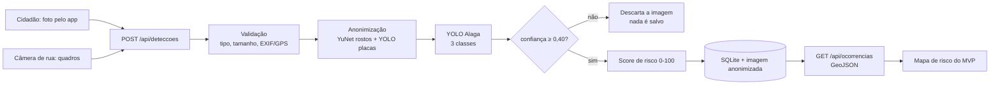

# Alaga Alerta — Visão Computacional

Detector YOLO de **rua alagada**, **bueiro entupido** e **veículo submerso** em fotos enviadas por cidadãos ou
quadros de câmeras de rua. Cada foto é anonimizada (rostos e placas borrados), analisada pelo modelo e, se houver
evidência, vira uma **ocorrência confirmada no mapa de risco** do MVP.

## Integrantes

| Nome completo | RM |
|---|---|
| Felipe Capriotti | RM98460 |
| Gustavo Kawamura | RM99679 |
| Manoella Herrerias Waideman | RM98906 |
| Victor Hugo Andrade | RM550996 |

## Entregáveis

| Item | Onde |
|---|---|
| Modelo servido por API (`POST /api/deteccoes`) | [alaga_vision/api.py](alaga_vision/api.py) |
| Cidadão envia foto e a detecção aparece no mapa | [web/](web/) (servido pela própria API em `/`) |
| Fluxo foto → anonimização → modelo → API → mapa | [Arquitetura](#arquitetura) |
| Dataset documentado (origem, classes, quantidades, divisão) | [docs/DATASET.md](docs/DATASET.md) + [docs/dataset_stats.md](docs/dataset_stats.md) (gerado); revisão dos bueiros em [training/bueiros_commons.csv](training/bueiros_commons.csv) |
| Métricas do treino (mAP, precisão, recall) | [docs/metricas.md](docs/metricas.md) (gerado por `scripts/evaluate.py`) |
| Treino | `scripts/train.py` (modelo entregue: CPU local) e [notebooks/treino_colab.ipynb](notebooks/treino_colab.ipynb) (GPU) |
| PDF | [docs/Relatorio_AlagaAlerta.pdf](docs/Relatorio_AlagaAlerta.pdf) |
| Vídeo de demonstração | [preencher com o link do YouTube] |
| Integração com a API central do MVP | [alaga_vision/mvp.py](alaga_vision/mvp.py) (ver [seção](#integração-com-a-api-central-do-mvp)) |

## Arquitetura



1. **Entrada**: upload `multipart/form-data` com a foto, latitude/longitude (ou GPS do EXIF da foto) e origem (`cidadao`/`camera`).
2. **Validação**: tipo e tamanho do arquivo; a imagem é orientada pelo EXIF e reduzida para no máx. 1920 px.
3. **Anonimização (LGPD)**: rostos (YuNet, duas escalas) e placas (YOLOv11n de placas) são pixelizados + desfocados
   **antes** de a imagem chegar ao modelo ou ao disco. A foto original nunca é gravada.
4. **Detecção**: YOLO26 fine-tuned nas 3 classes.
5. **Risco**: regra explicável ([alaga_vision/risk.py](alaga_vision/risk.py)) converte as detecções em score 0–100 e nível baixo/médio/alto.
6. **Publicação**: se alguma detecção passar do limiar de confirmação, a ocorrência é salva e aparece no mapa via GeoJSON.

## Classes

| Classe | O que é | Peso no risco |
|---|---|---|
| `rua_alagada` | lâmina d'água cobrindo o leito da rua/calçada | 0,60 → 0,90 (cresce com a área alagada na foto) |
| `bueiro_entupido` | boca de lobo/bueiro obstruído por lixo, folhas ou sedimento | 0,40 (risco preventivo) |
| `veiculo_submerso` | veículo com água pelo menos na altura das rodas | 1,00 (risco direto à vida) |

`score = max(peso × confiança) + 5 por tipo de evidência adicional na mesma foto` → **alto ≥ 60**, **médio ≥ 30**, baixo < 30.

## Resultados (conjunto de teste)

| Classe | Precisão | Recall | mAP@50 | mAP@50-95 |
|---|---:|---:|---:|---:|
| rua_alagada | 0,90 | 0,76 | 0,89 | 0,65 |
| bueiro_entupido | 0,56 | 0,60 | 0,57 | 0,29 |
| veiculo_submerso | 0,78 | 0,62 | 0,72 | 0,57 |
| **todas** | **0,75** | **0,66** | **0,73** | **0,50** |

Por foto, no limiar da API (0,40): 108 de 119 fotos com alagamento/bueiro viraram ocorrência (91%) e 4 de 35 fotos
sem nada geraram alarme falso (11%). YOLO26n, 448 px: ~23 ms por imagem em CPU; ~140 ms por foto na API com
anonimização. Detalhes, matriz de confusão e análise em [docs/metricas.md](docs/metricas.md) e no relatório PDF.

## Como rodar

Requisitos: Python 3.10+.

```bash
python -m venv .venv
.venv\Scripts\activate          # Windows  (Linux/macOS: source .venv/bin/activate)
pip install -r requirements.txt

# os pesos necessários já estão em models/ (detector treinado + anonimização de rostos e placas)

uvicorn alaga_vision.api:app --host 0.0.0.0 --port 8000
```

- Mapa + envio de foto: <http://localhost:8000>
- Documentação interativa da API (Swagger): <http://localhost:8000/docs>
- Para testar pelo celular na mesma rede: `http://<IP-do-PC>:8000` (a geolocalização do navegador exige HTTPS fora de `localhost`; sem ela, marque o local clicando no mapa).

Sem `models/alaga_yolo.pt` a API sobe, mas `POST /api/deteccoes` responde 503. Sem os modelos de anonimização ela
também recusa fotos (503): **nenhuma imagem é processada sem anonimização** (fail-closed).

Testes: `pytest` (rodam sem GPU e sem pesos, com detector falso).

### Configuração (variáveis de ambiente)

| Variável | Padrão | Uso |
|---|---|---|
| `ALAGA_MODEL` | `models/alaga_yolo.pt` | pesos do detector |
| `ALAGA_CONF` | `0.25` | confiança mínima para reportar uma caixa |
| `ALAGA_CONFIRM_CONF` | `0.40` | confiança mínima para virar ocorrência no mapa |
| `ALAGA_DATA_DIR` | `data/app` | banco SQLite e imagens anonimizadas |
| `ALAGA_MAX_SIDE` | `1920` | lado maior máximo da imagem processada |
| `ALAGA_AUTO_DOWNLOAD` | `1` | baixa os modelos de anonimização na 1ª execução |
| `MVP_URL` | vazio | URL da API central do MVP (ex.: `https://alaga-alerta-mvp.onrender.com`) |
| `MVP_API_KEY` | vazio | chave da API central; nunca no código nem no Git |

## Treino

Todas as fontes do dataset são públicas e baixam **sem login** (Kaggle + Wikimedia Commons). O notebook
[notebooks/treino_colab.ipynb](notebooks/treino_colab.ipynb) roda tudo numa GPU do Colab; fora dele:

```bash
python scripts/coletar_bueiros.py                   # fotos de bueiro revisadas (training/bueiros_commons.csv)
python scripts/prepare_dataset.py --inspecionar     # baixa o Kaggle e mostra as caixas geradas por fonte
python scripts/prepare_dataset.py                   # monta data/alaga (train/val/test) + docs/dataset_stats.*
python scripts/train.py --modelo yolo26s.pt --epocas 100                 # GPU
python scripts/train.py --modelo yolo26n.pt --imgsz 448 --epocas 50 --device cpu --projeto C:/alaga_runs   # só CPU
python scripts/evaluate.py                          # docs/metricas.* + docs/figuras/
```

O modelo entregue foi treinado em CPU com o comando "só CPU" acima (Ryzen 7 5700G: 38 épocas em 1,7 h, parada antecipada). Em pastas
sincronizadas (OneDrive/Dropbox), use `--projeto` fora delas: o sincronizador trava os pesos que o treino regrava a cada época.

As fontes, os pseudo-rótulos e o mapeamento de classes ficam em [training/datasets.yaml](training/datasets.yaml).
Detalhes e limitações em [docs/DATASET.md](docs/DATASET.md). Com uma `ROBOFLOW_API_KEY` (conta grátis), entram também
os reforços opcionais do Roboflow Universe.


## API

### `POST /api/deteccoes`

`multipart/form-data`:

| Campo | Tipo | Obrigatório | Descrição |
|---|---|---|---|
| `imagem` | arquivo | sim | JPG, PNG ou WEBP, até 15 MB |
| `latitude`, `longitude` | número | se a foto não tiver GPS | local da foto |
| `origem` | `cidadao` \| `camera` | não | padrão `cidadao` |
| `camera_id` | texto | não | identificador da câmera |
| `descricao` | texto | não | até 500 caracteres |

```bash
curl -F imagem=@rua.jpg -F latitude=-23.5614 -F longitude=-46.6559 http://localhost:8000/api/deteccoes
```

Resposta (resumida):

```json
{
  "confirmada": true,
  "deteccoes": [{"classe": "veiculo_submerso", "rotulo": "Veículo submerso", "confianca": 0.87, "bbox": [412, 300, 890, 610], "area_rel": 0.12}],
  "risco": {"score": 87, "nivel": "alto", "motivo": "Veículo submerso (87% de confiança)."},
  "anonimizacao": {"rostos": 2, "placas": 1, "metodo_rostos": "yunet", "metodo_placas": "yolo-placas"},
  "localizacao": {"latitude": -23.5614, "longitude": -46.6559, "fonte": "formulario"},
  "ocorrencia": {"id": "a1b2c3d4e5f6", "imagem_anotada_url": "http://localhost:8000/media/a1b2c3d4e5f6_anotada.jpg", "...": "..."},
  "tempo_ms": {"leitura": 12, "anonimizacao": 48, "deteccao": 95}
}
```

Códigos: `422` imagem inválida ou sem localização · `413` arquivo grande · `415` tipo não suportado · `503` modelo ou anonimização indisponível.

### `GET /api/ocorrencias?horas=24&nivel_minimo=medio`

Ocorrências confirmadas em **GeoJSON** (`FeatureCollection` de `Point`), pronto para Leaflet, Mapbox ou Google Maps.

### Outros

`GET /api/ocorrencias/{id}` · `GET /api/health` · `GET /api/classes` · `GET /media/{arquivo}`

### Integração com a API central do MVP

Com `MVP_URL` e `MVP_API_KEY` definidas, cada ocorrência confirmada também é publicada na API central do Alaga Alerta
(o mesmo backend do site do cidadão): a API de visão encontra o bairro monitorado mais próximo da foto
(`GET /bairros`, até 15 km) e envia `POST /deteccoes` com a chave no cabeçalho `X-API-Key`:

```json
{"bairro_id": "penha", "imagem_anonimizada": true,
 "deteccoes": [{"classe": "rua_alagada", "confianca": 0.81}, {"classe": "veiculo_submerso", "confianca": 0.78}]}
```

No MVP, a ocorrência aparece na lista "Ocorrências nas últimas 24 horas" e o bairro sobe para risco alto no mapa
("Alagamento confirmado no bairro"). A imagem não é enviada: só classe, confiança e bairro (minimização de dados).
Se o MVP estiver fora do ar ou recusar a chave, a análise da foto segue normal e a resposta traz
`"mvp": {"publicada": false, "motivo": ...}`; a chave nunca aparece em logs nem respostas. Sem as variáveis, a
integração fica desligada. Testes em [tests/test_mvp.py](tests/test_mvp.py).

```bash
# Windows PowerShell
$env:MVP_URL="https://alaga-alerta-mvp.onrender.com"; $env:MVP_API_KEY="<chave>"
uvicorn alaga_vision.api:app --host 0.0.0.0 --port 8000
```

### Integração com outro front do MVP

A API libera CORS. Num front separado basta:

```js
const fd = new FormData();
fd.append("imagem", arquivo);
fd.append("latitude", lat);
fd.append("longitude", lon);
const r = await fetch("http://<api>:8000/api/deteccoes", { method: "POST", body: fd }).then((r) => r.json());

const geojson = await fetch("http://<api>:8000/api/ocorrencias?horas=24").then((r) => r.json());
L.geoJSON(geojson).addTo(mapa); // Leaflet
```

Para câmeras: `python scripts/simular_camera.py --fonte video.mp4 --lat ... --lon ... --camera cam-01`.

## Privacidade (LGPD)

- Rostos e placas são borrados **antes** de qualquer armazenamento ou inferência; a foto original fica só em memória.
- Fail-closed: sem os modelos de anonimização, a API não aceita fotos.
- Fotos sem alagamento confirmado são descartadas (minimização de dados).
- Metadados EXIF (GPS, aparelho) são removidos: a imagem é recodificada; o GPS é usado só para posicionar a ocorrência.
- Modelos de terceiros são carregados em ONNX (não executam código ao carregar, ao contrário de `.pt`/pickle).

## Estrutura

```
alaga_vision/        API e pipeline (config, anonimização, detector, risco, imagem, banco)
web/                 front de demonstração do MVP (Leaflet)
scripts/             coletar_bueiros, prepare_dataset, train, evaluate, download_models, simular_camera
training/            datasets.yaml (fontes + mapeamento) e bueiros_commons.csv (revisão das fotos de bueiro)
notebooks/           treino no Colab
docs/                relatório, dataset, métricas e figuras
tests/               pytest (API ponta a ponta com detector falso, risco, anonimização)
models/              pesos do detector treinado e dos modelos de anonimização
```

## Limitações e próximos passos

- Caixas delimitadoras são uma aproximação para "área alagada"; um modelo de **segmentação** (YOLO-seg) mediria melhor a extensão da água.
- O modelo não estima **profundidade**; o peso de `veiculo_submerso` é o melhor indicador disponível. Próximo passo: estimar nível da água pela altura em relação a rodas/meio-fio.
- Datasets públicos têm poucas imagens brasileiras e poucos bueiros entupidos (a classe mais fraca); incluir fotos próprias de SP (fonte `proprias` no YAML) é o passo de maior impacto.
- `veiculo_submerso` foi rotulado automaticamente (veículo do YOLO-COCO + máscara de água); há ruído de rótulo.
- Reflexos de rua molhada (sem alagamento) são o falso positivo mais provável: incluir negativos assim no treino.
- Ocorrências não expiram nem são agregadas por região; o mapa filtra por janela de tempo.

## Licença

Código sob AGPL-3.0, por usar o Ultralytics YOLO (AGPL-3.0). Datasets e modelos de terceiros mantêm suas licenças (ver [docs/DATASET.md](docs/DATASET.md) e [models/README.md](models/README.md)).
